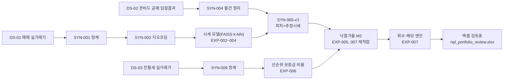

# npl-el-pipeline

서울 빌라 NPL(부실채권) 담보의 시장가치·공매 낙찰가율·매각 시점을 추정해 회수액(LGD)을 계산하는 파이프라인이다.

## 문제 정의

NPL 담보 회수액을 다음 식으로 추정한다.

```
예상 매각가 = 시세(또는 감정가) × 낙찰가율
회수액 R   = 배당 순서(집행비용 → 최우선변제 → 당해세 → 선순위보증금잔액 → 본채권)를 거친 뒤 본채권에 남는 금액
PV         = R ÷ (1+할인율)^(매각 시점까지의 연수)
LGD        = 1 − PV ÷ EAD
```

시세는 실거래가 비교사례(FAISS k-NN)로, 낙찰가율은 공매 낙찰 기록으로, 매각 시점은 Kaplan-Meier로 추정한다.

## 파이프라인



## 데이터와 출처

| ID | 이름 | 출처 | 수집 기간 |
|---|---|---|---|
| DS-01 | 연립다세대 매매 실거래가 | 공공데이터포털 부동산 실거래가 API | 2024-11~2026-10 |
| DS-02 | 온비드 물건 입찰결과목록(서울 주거용) | 온비드 공매 API | 2024-11~2026-10 |
| DS-03 | 연립다세대 전월세 실거래가 | 공공데이터포털 부동산 전월세 실거래가 API | 신규 호출 624건(상한 1,000건) |
| - | 건축물대장 표제부(사용승인연도) | 국토교통부 건축HUB API | 조회 117건(물건 277건) |
| - | 지번 지오코딩 | 카카오 로컬 API | - |

전체 데이터셋 명세는 `docs/DATASETS.md`, 실험 대장은 `docs/EXPERIMENTS.md`를 참조한다.

## 실험 요약 (EXP-001~007)

| ID | 제목 | 판정 | 핵심 숫자 | 결과 파일 | 비고 |
|---|---|---|---|---|---|
| EXP-001 | 직거래 EDA | 직거래 기본 제외 | 상대가격 중앙값 0.912, IQR비율 1.39배 | `results/exp001_direct_deal.md` | |
| EXP-002 | 시세 추정 기준선 | 채택(B1) | pooled MdAPE: B0 24.52% / B1 17.04% | `results/exp002_baseline.md` | |
| EXP-003 | FAISS k-NN 비교사례 | 채택(FAISS) | pooled MdAPE: B1 17.04% / FAISS 14.58% | `results/exp003_faiss.md` | |
| EXP-004 | FAISS 탐색 범위 확장 | 채택(EXP-004, k=2, 위치가중치16.0) | pooled MdAPE: 14.58% → 13.35% | `results/exp004_faiss_ext.md` | |
| EXP-005 | 공매 낙찰가율·매각 시점 | 채택(M2) | LOO MdAE(정정): rho_appr 6.67%p / rho_mkt 14.00%p | `results/exp005_auction.md` | |
| EXP-006 | 공매 정제 보강 + 인수부담 혼합 구조 | 기각(혼합 가설), M2 유지 | 보증금비율 차이 −0.333(기준 ≥0.20, 방향 반전) | `results/exp006_mixture.md` | |
| EXP-007 | 회수액·LGD + 20건 포트폴리오 엑셀 | 완료 기준 충족 | 포트폴리오 LGD(시세/보증금기본/기본시나리오) 57.4%(20건) (EXP-010: 일괄매각 의심 1건 제외 시 79.0%, 19건) | `results/exp007_recovery.md`, `results/npl_portfolio_review.xlsx` | 엑셀 재계산 검증 완료(LibreOffice, 수식 오류 0건, 요약값 표4와 일치) |

숫자는 모두 각 결과 파일에서 그대로 옮겼다.

## 주요 발견 3개

1. **직거래 구성 효과(EXP-001)**: 직거래는 원분포 기준으로 중개거래보다 가격이 8.9% 높지만(신축 비중이 큰 구성 효과), 법정동×연식×면적 셀로 보정하면 8.8% 낮아져 방향이 반대가 된다. 비교사례에서 직거래를 기본 제외한 이유다.
2. **FAISS 비교사례 시세 모델 개선(EXP-002~004)**: 셀 기반 기준선(MdAPE 17.04%) → FAISS k-NN(14.58%) → 탐색 범위 확장(13.35%)으로 단계적으로 개선됐다.
3. **공매 빌라의 낮은 매각 확률과 극단 저가 낙찰(EXP-005~006)**: 왼쪽 절단을 제외한 기본 Kaplan-Meier 기준 365일 매각 확률은 15.6%(관측 최대 644일 18.0%)에 불과하다. 일부 물건은 감정가·시세 대비 1~26%의 극단적으로 낮은 가격에 낙찰되는데, 선순위 임차보증금 인수부담 가설은 보증금 지표의 측정 한계(최근 계약만 관측, 전세·월세 혼합, 유효 6건)로 검증하지 못했다(EXP-006).

## 한계와 다음 할 일

- 극단 저가 낙찰 물건(9건)의 원인 규명 — 매각물건명세서의 임차인·대항력 정보 확인 필요(EXP-006).
- 낙찰가율 분해 — 최종 회차 최저가 비율을 변수로 추가 검토(EXP-005 표11, 이번 실험들에서는 보류).
- 회차 리셋(13.1%)을 반영한 매각 시점 모형 — 현재 지연 진입 KM은 신뢰도가 낮다(EXP-006).
- 보증금 측정 한계 — 전월세 수집 기간이 원 임대차 계약 시점보다 늦을 수 있고, 전세·월세가 혼재한다(EXP-006).
- rho_appr과 rho_mkt 중 회수액 추정에 어느 쪽을 우선할지(또는 두 경로를 계속 병기할지) 결정 필요(EXP-005, 007).
- FAISS 탐색 범위 확장은 EXP-004가 마지막이다(사용자 결정) — 같은 건물 이웃 의존도가 높아 공매처럼 같은 건물 거래가 적은 경우의 성능은 별도 점검 과제로 남는다.

## 참고한 것과 직접 판단한 것

| 항목 | 참고한 것(외부 근거) | 직접 판단한 것(이번 프로젝트에서 결정) |
|---|---|---|
| 시세 모델 구조 | FAISS k-NN(표준 기법) | k, 위치/면적/연식/층 가중치 탐색 범위(EXP-002~004) |
| 최우선변제 기준 | 서울 소액임차인 보증금 1.65억 원 이하 → 최우선변제 5,500만 원(현행 기준표, **법령 원문 확인 필요**) | 그 외 모든 채권 가정값(LTV, 약정·연체금리, 집행비용율, 할인율, 채권최고액 비율)은 전부 가상값 |
| 배당 순서 | 실제 경매 배당 순서의 단순화 구조(집행비용→최우선변제→당해세→후순위) | 흡수배당·임금채권·가압류 안분배당·당해세 예외(2023-04-01)·상가 환산보증금은 범위 밖으로 제외 |
| 매각 시점 시나리오 | EXP-006 Kaplan-Meier(365일 매각확률 15.6%) + 법원경매 평균 약 412일(2005~2015, 오래된 통계) | 낙관 12개월/기본 24개월/비관 36개월이라는 구체적 구간 값 |
| 데이터 범위 | 공공데이터포털·온비드·건축HUB·카카오 공개 API | 공매(온비드)≠법원경매라는 점을 결과 해석에 유지(수치를 혼용하지 않음) |

## 재현 방법

```bash
# 1. 가상환경 준비(uv)
uv venv
uv pip install -r requirements.txt

# 2. .env 파일에 아래 키를 채운다(값은 각자 발급받아야 하며, 이 저장소에는 값을 포함하지 않는다)
#    DATA_GO_KR_API_KEY, RH_TRADE_URL, RH_RENT_URL
#    ONBID_ITEM_RESULT_LIST_URL, ONBID_ITEM_RESULT_DETAIL_URL
#    KAKAO_REST_API_KEY, KAKAO_GEOCODE_URL
#    BLD_TITLE_URL

# 3. 실행 순서(이미 수집된 데이터는 data/ 아래 로컬에 있으며 git에는 올리지 않는다)
uv run python src/parse_clean.py          # SYN-001
uv run python src/geocode.py              # SYN-002
uv run python src/knn_comps.py            # EXP-003 FAISS
uv run python src/parse_onbid.py          # SYN-004
uv run python src/onbid_features_v3.py    # SYN-005-v3 (호수 중복 제거 + 연식 보강 + 시세 재계산)
uv run python src/parse_rent.py           # SYN-006
uv run python src/deposit_ratio.py        # 보증금 비율
uv run python src/mixture_test.py         # EXP-006 혼합 구조 판정
uv run python src/time_to_sale_v3.py      # 매각 시점 KM

uv run pytest tests/test_recovery_engine.py   # 회수 엔진 단위 테스트 6건
uv run python src/rho_refit_v3.py             # v3 M2 재적합 + LOO + 두 경로 비교
uv run python src/build_portfolio.py          # SYN-008 포트폴리오 20건
uv run python src/run_recovery_grid.py        # 회수 엔진 그리드(360행)
uv run python src/build_excel.py              # results/npl_portfolio_review.xlsx
```

데이터 파일(`data/`)과 산출 parquet/json은 git에 커밋하지 않는다(`.gitignore` 참조). 실험 규칙은 `docs/TRACKING_RULES.md`, 전체 실험 기록은 `docs/EXPERIMENTS.md`, 데이터셋 명세는 `docs/DATASETS.md`를 참조한다.
